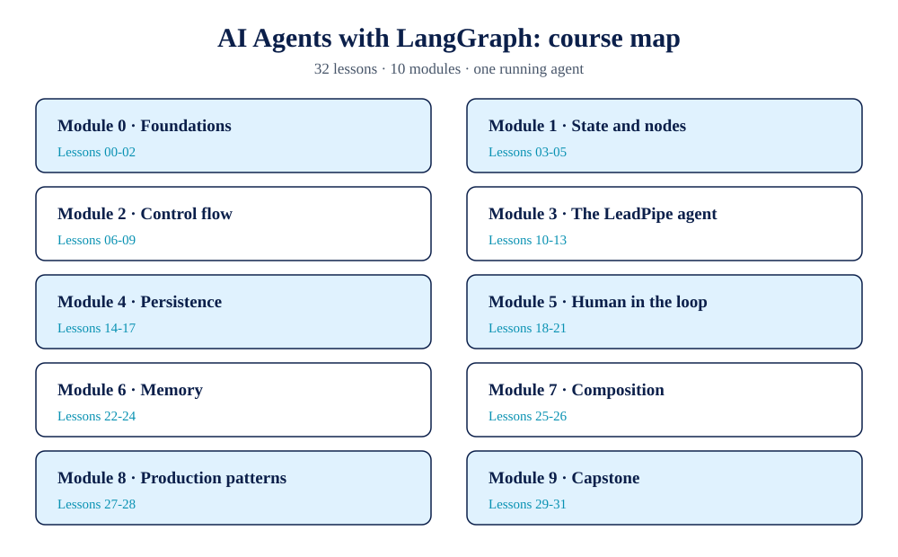

# AI Agents with LangGraph

Build agents as state graphs: typed state, nodes and edges, conditional routing, cycles, checkpoints, human-in-the-loop interrupts, memory stores, and production patterns, taught through one running example (a lead qualification and booking agent) and measured at every step.



**No API keys. No hosted models. No network.** Every lesson runs offline on the Python standard library. That is possible because the runnable track uses a small local graph engine (`lgx/`, in this repo) that mirrors LangGraph's semantics: state channels with reducers, node functions returning partial updates, conditional edges, cycles with a step limit, checkpoints at super-step boundaries, interrupts that re-execute their node on resume, Send-style fan-out, and a cross-thread memory store. It is a teaching stand-in, labelled as one in every lesson. It is not LangGraph, and this course never claims it is.

What you get in exchange for the stand-in is verifiability: every number in every lesson is produced by that lesson's own code on the bundled fixtures and asserted by its smoke test. Each lesson also shows the equivalent real LangGraph code (the 1.2.x line) as a labelled reference snippet, mapped one-to-one to the stand-in, so the transfer to the real framework is explicit. Framework claims are sourced and dated in [RESEARCH.md](RESEARCH.md); nothing sourced is ever presented as something the course measured.

## What you will learn

- To design an agent's state schema first (channels, defaults, reducers) and let nodes be small functions over it.
- To route, loop, and fan out with conditional edges, cycles, and Send, and to price each pattern in executions, super-steps, and bookkeeping.
- To make runs durable: checkpoints, threads, crash recovery, and time-travel forks.
- To put humans in the loop safely: interrupts, approval gates placed before the act they approve, state editing at breakpoints, and rejection paths that fail closed.
- To manage memory as a policy question: what earns a write to the long-term store, and what stale memory costs when the policy is wrong.
- To run agents in production shapes: subgraphs, streaming, batches over threads, retries with idempotency.
- To specify a capstone with gates fixed before the build, then harden it decision by decision against those gates.

## Capstone scorecard

The capstone (Lessons 29 to 31) grades two variants of the LeadPipe agent against gates fixed in writing before either was built.

| Metric (gate) | Gate | As-built | Hardened |
|---|---|---|---|
| Band accuracy (min) | 0.9 | 1.0 | 1.0 |
| Task success rate (min) | 0.9 | 0.8333 | 1.0 |
| Policy escapes (max) | 0 | 1 | 0 |
| Crash-lead bookings (exact) | 1 | 2 | 1 |
| Booking ledger entries (exact) | 4 | 6 | 4 |
| Mean steps per lead (max) | 6.0 | 5.17 | 4.92 |
| **Gates passed** | **6** | **2** | **6** |

The variants differ in exactly three decisions: where the approval interrupt stands, whether the booking node checks the ledger before writing, and how many clarification rounds a lead gets.

## Course map

| # | Lesson | Module |
|---|---|---|
| 00 | Course Setup and the Stand-in Lab | 0 · Foundations |
| 01 | Why Graphs, Measured | 0 · Foundations |
| 02 | Anatomy of a Run | 0 · Foundations |
| 03 | State Schemas and Channels | 1 · State and nodes |
| 04 | Reducers Decide What an Update Means | 1 · State and nodes |
| 05 | Nodes and Partial Updates | 1 · State and nodes |
| 06 | Edges and Termination | 2 · Control flow |
| 07 | Conditional Edges and Routers | 2 · Control flow |
| 08 | Cycles and the ReAct Loop | 2 · Control flow |
| 09 | Fan-Out with Send, and What the Merge Costs | 2 · Control flow |
| 10 | Tools as Nodes | 3 · The LeadPipe agent |
| 11 | The Scoring Node | 3 · The LeadPipe agent |
| 12 | Routing by Band, the Full Path Inventory | 3 · The LeadPipe agent |
| 13 | Clarification Cycles | 3 · The LeadPipe agent |
| 14 | Checkpointing Every Super-Step | 4 · Persistence |
| 15 | Threads and State History | 4 · Persistence |
| 16 | Crash and Resume (Durable Execution) | 4 · Persistence |
| 17 | Time Travel and Forks | 4 · Persistence |
| 18 | Interrupts and Resume Values | 5 · Human in the loop |
| 19 | The Approval Gate | 5 · Human in the loop |
| 20 | Editing State at a Breakpoint | 5 · Human in the loop |
| 21 | Rejection and Escalation Paths | 5 · Human in the loop |
| 22 | Two Kinds of Memory | 6 · Memory |
| 23 | The Store, Namespaces, and Keys | 6 · Memory |
| 24 | Memory Write Policies, Measured | 6 · Memory |
| 25 | Subgraphs | 7 · Composition |
| 26 | Streaming Modes | 7 · Composition |
| 27 | Batch Processing over Threads | 8 · Production patterns |
| 28 | Failures, Retries, and Idempotency | 8 · Production patterns |
| 29 | Capstone Specification and Gates | 9 · Capstone |
| 30 | Build the Capstone Agent | 9 · Capstone |
| 31 | Evaluate and Harden | 9 · Capstone |

## How to run it

You need Python 3.10 or newer and nothing else.

```
# any lesson, from its own folder:
cd 13-clarification-cycles
python3 clarify_lab.py     # prints the measurements as JSON
python3 smoke_test.py      # asserts them: "smoke ok"

# whole-course checks, from the repo root:
python3 -m compileall .
python3 tools/validate_course.py
python3 tools/check_links.py
```

## Repository layout

- `lgx/`: the stand-in engine (graph executor, checkpointers, store, model stand-in) and the LeadPipe domain (`agent.py`).
- `fixtures/`: twelve leads with truth records, the booking schedule, the policy and rubric, and the memory cases.
- Numbered folders: the 32 lessons, each with a README, a runnable lab, an exercise, a smoke test, and a worked solution.
- `assets/visuals/`: the branded figures and their generator script.
- `resources/`: decision cards distilled from the course's measurements.
- `tools/`: the course validators run by CI.
- `RESEARCH.md`: the dated field scan (LangGraph 1.2.20, the official Academy course, and the gap this course fills) and the stand-in-to-framework mapping.
- `DESIGN.md`: the course design and its honesty rules.

## Honest negatives

This course reports where its own subject loses, in print, with numbers:

- **Graphs cost more on linear work.** On this course's mostly linear flow, a plain pipeline makes 56 calls; the graph makes 59 executions and writes 84 checkpoints the pipeline never writes (Lesson 01). The graph buys pause, resume, recovery, and audit; if you need none of them, do not pay for it.
- **Fan-out is not free.** It ties sequential execution on work done (48 executions each), and its win in super-steps and modelled latency (36 and 60 against 48 and 84) is paid for with 24 branch state copies and a merge where one overwrite silently wins (Lesson 09).
- **Memory written carelessly is worse than no memory.** Saving everything scored 3 of 6 on returning-lead recall; the misses were stale and unconfirmed facts presented as current truth (Lesson 24).
- **The capstone's first build failed most of its gates.** The as-built variant passed 2 of 6, including booking a lead its approver had rejected and double-booking the crash lead (Lesson 31). The fixes were three decisions, each taught by an earlier lesson; the course keeps the failing verdict in print because that is what the gates are for.

## About TechAurah

This course is part of the TechAurah free academy: a series of complete, runnable, honestly measured courses on agentic AI, published by TechAura (AI and Software Engineering). Explore the other courses and projects at https://github.com/techaurah, and the company at https://www.linkedin.com/company/techaurah/.

## License

MIT. See [LICENSE](LICENSE).
